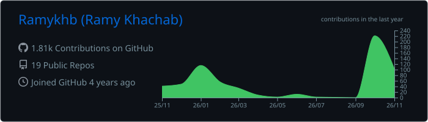
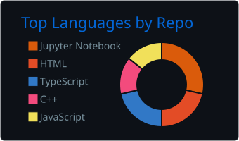
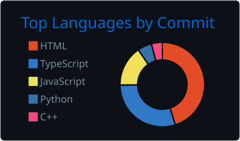
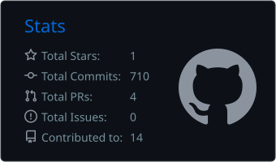
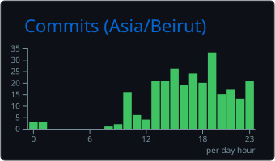

<div align="center">

# RAMY KHACHAB

### From the interface to the intelligence behind it.

Full Stack Engineer · Aspiring AI Engineer

Building applications that connect people with intelligent systems.<br/>
Currently developing Sora — AI-assisted navigation for blind people.

<br/>

<a href="https://ramykhachab.dev"></a>
<a href="https://www.linkedin.com/in/ramykhachab"></a>
<a href="mailto:ramykhb18@gmail.com"></a>

</div>

---

```text
┌─ ramy / workspace ─────────────────────────────────────┐
│                                                        │
│  role       Full Stack Engineer                        │
│  building   Sora · AI-assisted navigation              │
│  shipped    WatchWise · SitMyPet                       │
│  exploring  Deep Learning + AI Engineering             │
│  status     Open to projects and opportunities         │
│                                                        │
└────────────────────────────────────────────────────────┘
```

## About Me

I enjoy building the whole application: the interface someone interacts
with, the backend logic behind it, and the AI capabilities that bring it to life.

My foundation is full stack engineering, and I’m especially interested in
AI engineering: turning models into useful features and complete applications.
I enjoy building software that can interpret its surroundings and respond
in useful ways.

With Sora, that direction is becoming a concrete project: connecting
a mobile experience to continuous AI analysis of camera frames.

## Currently Building

### Sora

`Mobile application` · `Computer vision` · `Streaming` · `Accessibility`

**Turning camera frames into awareness of the path ahead.**

Sora is a mobile application being developed to help blind people
understand their surroundings while holding their phone.

Its AI backend continuously analyzes camera frames to detect obstacles
and assess whether the path ahead appears clear, then streams feedback
back to the application.

```text
   PHONE CAMERA
        │
        ▼
   Camera frames
        │
        ▼
   AI BACKEND
   Analyze the scene
   Detect obstacles
   Assess the path ahead
        │
        ▼
   Continuous feedback
        │
        ▼
   MOBILE APPLICATION
```

**Currently working on:** connecting continuous visual analysis with
timely, useful feedback in the mobile experience.

**Status:** In development

## Tech Stack

<table>
<tr>
<td width="50%" valign="top">

### Languages


### Frontend & Mobile


React Native for mobile applications.

</td>
<td width="50%" valign="top">

### Backend


### Databases


</td>
</tr>
<tr>
<td width="50%" valign="top">

### AI & Machine Learning


Exploring deep learning architectures and AI engineering,
with a focus on integrating models into real applications.

</td>
<td width="50%" valign="top">

### Tools & Design


Tools for versioning, building, and designing.

</td>
</tr>
</table>

## Completed Projects

### WatchWise

`React` · `TypeScript` · `Laravel` · `Real-time` · `AI`

**Discover better. Watch together.**

A movie and TV discovery platform that brings finding something to watch
and sharing the experience into one place.

- Personalized recommendations, including weather-aware movie picks.
- Watchlists, custom lists, ratings, and reviews.
- Collaborative movie nights with invitations and film voting.
- Live discussion rooms powered by Laravel Reverb.
- A conversational AI assistant and AI-assisted review analysis.
- Social profiles, following, and administration tools.

**Stack:** React · TypeScript · Laravel · PHP · SQLite · TMDB · Groq<br/>
**Status:** Completed

[Explore the repository ↗](https://github.com/Ramykhb/WatchWise)

---

### SitMyPet

`React Native` · `Mobile application` · `Pet care`

**Connecting pet owners with people who can care for their pets.**

A mobile application where pet owners create sitting requests
and pet sitters apply to help.

The project brought together mobile interfaces and the application
logic behind a pet care workflow.

**Status:** Completed

## GitHub Activity

A look at the work behind the repositories.

<p align="center">
  
</p>

<table>
<tr>
<td width="50%">

</td>
<td width="50%">

</td>
</tr>
<tr>
<td width="50%">

</td>
<td width="50%">

</td>
</tr>
</table>

<sub>Generated daily from GitHub activity. Language charts reflect repository activity, not proficiency.</sub>

## What I’m Learning

```text
                     FULL STACK ENGINEERING
                              │
                  ┌───────────┴───────────┐
                  ▼                       ▼
            DEEP LEARNING           AI ENGINEERING 
            Understanding          Integrating models
            the models             into applications
                  │                       │
                  └───────────┬───────────┘
                              ▼
                      AI IN PRODUCTION
                   From experiments to apps
                              │
                              ▼
                             SORA
                 Applying what I'm learning
```

My goal is to build production-ready AI applications — connecting models,
reliable backend systems, and interfaces that make the result useful.

## Connect With Me

I'm open to projects, collaborations, and engineering opportunities,
especially where full stack development meets AI engineering.

**[Send me an email ↗](mailto:ramykhb18@gmail.com)**

---

<div align="center">
<sub>Somewhere between shipping the next feature and understanding the next model.</sub>
</div>
